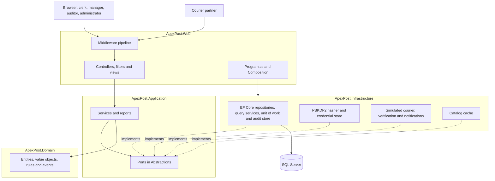
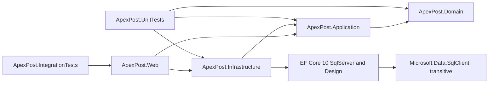
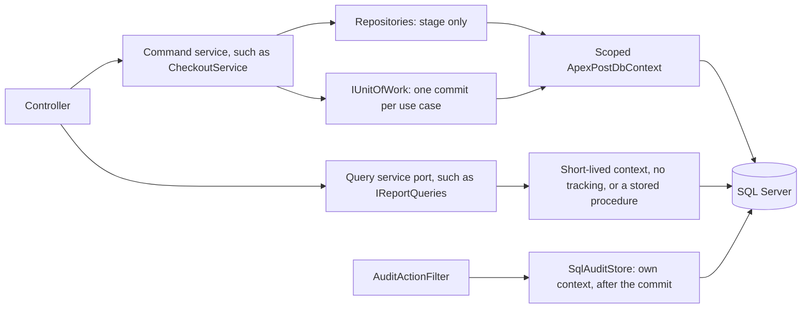
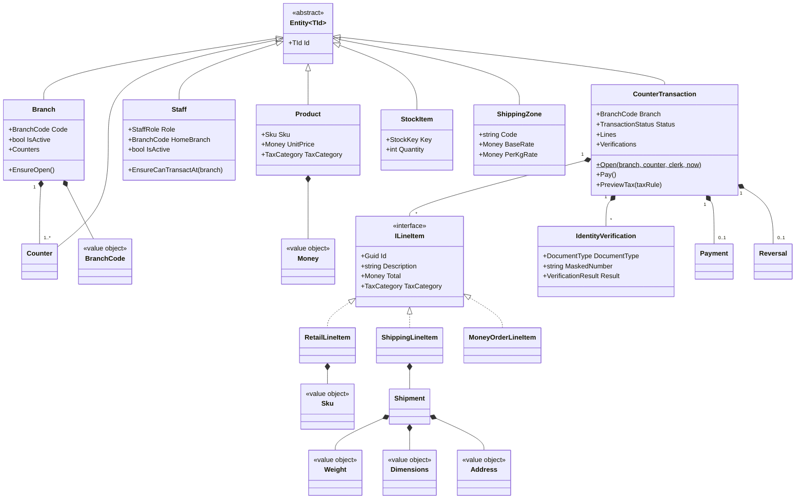
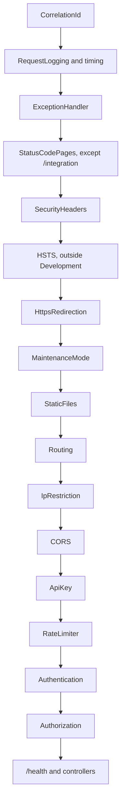
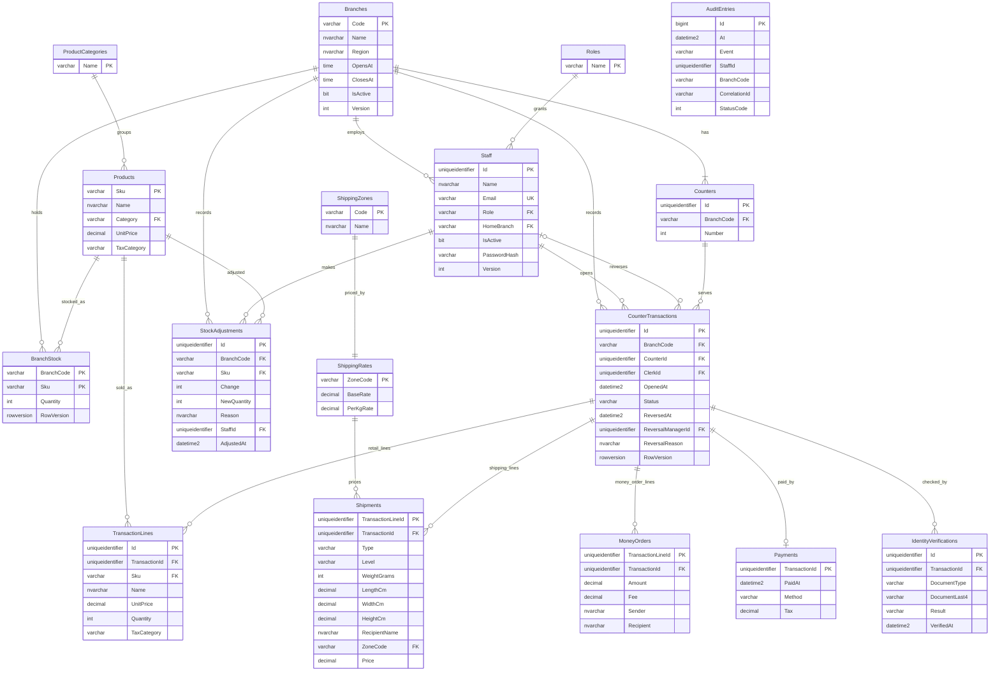

# ApexPost Counter Platform: design

This document explains how the platform is built and why. [README.md](README.md) explains how to run it. The
[decisions index](#decisions-index) at the end links each decision the brief asks for to the section that answers it.

## 1. Overview

ApexPost Logistics is moving its branches from single-purpose terminals to one counter that sells retail goods
alongside shipping, money orders and identity verification. This platform is that counter: a clerk opens a transaction,
builds one mixed basket, verifies identity if needed and takes payment.

The three goals of the brief shaped the design:

- **Secure:** every request passes a deliberate pipeline, and every business action checks role and branch.
- **Fast:** all I/O is asynchronous, concurrency is bounded, and frequently read data is cached.
- **Auditable:** each important action records the user, branch, time, outcome and correlation ID.

## 2. Architecture

The solution has four layers, and dependencies point inwards only.

| Project | Responsibility | May reference |
| --- | --- | --- |
| `ApexPost.Domain` | Business rules, with no knowledge of storage or the web | Nothing |
| `ApexPost.Application` | Use cases, ports, role and branch checks | Domain |
| `ApexPost.Infrastructure` | EF Core storage, hashing, cache and simulated partners | Application |
| `ApexPost.Web` | HTTP, pipeline, filters and views | Application, and Infrastructure in the composition root only |

### Project and package dependencies

Domain references nothing, and only Infrastructure knows EF Core. `System.Security.Cryptography.Pkcs` is pinned in
Infrastructure on purpose: `SqlClient` otherwise brings version 9.0.11, which `NuGetAudit` refuses for known
vulnerabilities (NU1902, NU1903).

### Reads and writes

There is one database and no separate read store. Writes go through repositories and one commit, and reads go through
query services or stored procedures.

The repository holds the projects under `src/` and `tests/`. `tests/ApexPost.UnitTests/Architecture/LayeringTests.cs`
and `tests/ApexPost.IntegrationTests/Architecture/ControllerLayeringTests.cs` enforce these rules by scanning signatures
and IL with plain reflection. A check of assembly references alone would miss `System.IO`, which lives in the core
library that every assembly references.

## 3. Domain model

Value objects have no identity: they are sealed records validated in their constructor, so an invalid `Money` or `Sku`
cannot exist. Entities have an identity and a life cycle, and compare by Id through `Entity<TId>`.

`CounterTransaction` is the aggregate root: `Open` is the only way to create one, and its status moves from Open to
Paid to Refunded, or from Open or Paid to Voided. Business-rule violations throw `DomainException` or a subclass.
How this model is stored is in [section 14](#14-database-schema-and-normalization).

## 4. Middleware pipeline and order

The order and reasons match the comments in `src/ApexPost.Web/Program.cs`.

| # | Step | Why it sits here |
| --- | --- | --- |
| 1 | CorrelationId | Every later step, its log entries and every response carry it |
| 2 | RequestLogging and timing | Wraps everything below, so failed and rejected requests are measured too |
| 3 | ExceptionHandler | Sits above all that can throw; `ProblemExceptionHandler` writes its log entries |
| 4 | StatusCodePages (`UseWhen`: not `/integration`) | Turns empty error responses into pages or JSON; partners get what the endpoint wrote, unchanged |
| 5 | SecurityHeaders | Before anything that can answer, so that every response below carries them |
| 6 | HSTS | Only outside Development, where a browser would remember it for localhost |
| 7 | HttpsRedirection | Before any content is served or any cookie is read |
| 8 | MaintenanceMode | Before static files and routing: a closed site answers nothing but `/health` |
| 9 | StaticFiles | Needs neither routing nor a signed-in user |
| 10 | Routing | Picks the endpoint, so the steps below can read its metadata |
| 11 | IpRestriction | The first endpoint check and the cheapest refusal, before any key or session is touched |
| 12 | CORS | Before the API key: a browser preflight carries no key and must be answered here |
| 13 | ApiKey | Names the partner, which the rate limiter needs next |
| 14 | RateLimiter | Before authentication: a rejected login attempt costs no cookie or password work |
| 15 | Authentication | Builds the user that authorization then checks |
| 16 | Authorization | Applies the named policies and the authenticated fallback policy |
| 17 | `/health` and controllers | Health is anonymous, because load balancers do not sign in |

`tests/ApexPost.IntegrationTests/Middleware/PipelineOrderTests.cs` proves the parts of this order that matter most, such
as IP restriction answering before the API key.

## 5. Filters versus middleware

Middleware sees every request but knows little about MVC. A filter runs only for an action, but can see the action, its
bound arguments and its result. Each concern went to the place that has the information it needs.

| Concern | Where | Why |
| --- | --- | --- |
| Correlation ID | Middleware | Must cover every request, including static files and rejected calls |
| Request logging and timing | Middleware | Must also time requests that never reach MVC |
| Exception handling | Middleware | Must catch failures from the whole pipeline |
| Security headers | Middleware | Every response needs them, whichever step answers |
| Maintenance mode | Middleware | Must stop requests before routing and static files |
| IP restriction and API key | Middleware | Refuse a call before MVC does any work, using endpoint metadata |
| Rate limiting | Middleware | Must run before password work |
| Audit | `AuditActionFilter` | Only MVC knows the action, its arguments and its result |
| Slow-action warning | `PerformanceFilter` | Measures the action alone and can name it; the timing middleware only knows the URL |
| Invalid input | `ValidationFilter` | Model state only exists after model binding |
| Branch ownership | `BranchAccessFilter` | Sees the bound `branch` argument; the `SameBranchOnly` policy runs before binding and sees only route and query |
| Form errors | `DomainExceptionFilter` | Only the controller knows which form to return to, for Post/Redirect/Get |

The filters are global and ordered in `src/ApexPost.Web/Filters/FilterOrder.cs`:

| Order | Filter | Reason for the position |
| --- | --- | --- |
| -1000 | `AuditActionFilter` | Outermost, so it also sees what the inner filters reject |
| -900 | `PerformanceFilter` | Measures the action together with its checks |
| -500 | `ValidationFilter` | Stops bad input before the action |
| -400 | `BranchAccessFilter` | Blocks another branch's data before the action |
| -300 | `DomainExceptionFilter` | Innermost, so audit reads the outcome of a handled failure |

## 6. Architecture decision records

### ADR-1: Keep the layered architecture

**Context:** The brief asks whether the Week 1 architecture survives the move to ApexPost.

**Options:** Keep the layers; merge everything into the MVC project; adopt vertical slices.

**Decision:** The Week 1 layered architecture (Domain, Application, Infrastructure and UI) was kept as the design. The
domain was designed new for ApexPost, and the project was built from scratch, not refactored from Week 1 code.

**Consequences:** Next week's database replaces only Infrastructure. Adding a feature touches several projects, and the
reflection tests stop the layers from drifting apart.

### ADR-2: Model the mixed basket with an interface

**Context:** One basket holds retail items, shipments and money orders, which share almost no data.

**Options:** A base class with subclasses; one class with optional fields; composition through an interface.

**Decision:** `CounterTransaction` holds a list of `ILineItem`, which only promises an Id, a description, a total and a
tax category. `RetailLineItem`, `ShippingLineItem` and `MoneyOrderLineItem` are separate records.

**Consequences:** A new kind of line needs no change to the basket's totals. Code that needs a specific kind filters with
`OfType`, and storage has to keep the kinds apart: one table per kind, see [ADR-014](#adr-014-domain-model-versus-persistence-model).

### ADR-3: Strategy for pricing and delegates for tax

**Context:** Shipping prices depend on zone, weight and service level; tax depends on the product's category. Rates must
come from configuration.

**Options:** One large method; rule objects for both; a mix chosen per problem.

**Decision:** Pricing uses `IShippingPricingStrategy`, one class per service level, chosen by pattern matching in
`ShippingPricing.For`. Chargeable weight is the larger of actual and volumetric weight, and the price is (base rate +
rate per kg × kg) × level multiplier. Tax is a `Func<ILineItem, Money>` built by `TaxRule.From`, with the percentage
chosen by pattern matching on `TaxCategory`. The low-stock rule is a `Predicate<StockItem>`.

**Consequences:** Domain rules take their rates as data and stay free of configuration. All three strategies currently
share one formula, so they differ only in their multiplier, which leaves room for a level to price differently later.

### ADR-4: JSON files behind repositories, with versions

**Context:** No database is allowed this week, but one replaces the files next week. Parallel requests must not lose
updates, and a crash must not damage a file.

**Options:** One shared file; direct file access in services; a generic repository per aggregate.

**Decision:** `IRepository<TEntity, TId>` is implemented by `JsonRepository`, with one file per aggregate. Each file has
its own `SemaphoreSlim`. A write goes to a temporary file and then replaces the real one. Every record has a `Version`,
and a stale update throws `ConcurrencyException`. A malformed file or a duplicate key raises a clear error instead of
being overwritten.

**Consequences:** Domain and Application know nothing about files. Every read parses a whole file, and work across two
files is not atomic. Week 3 replaced this storage in the running application: see
[Path to a database](#12-path-to-a-database).

### ADR-5: Deliberate middleware order

**Context:** Order decides what gets logged, protected and refused, and how much work a refused call costs.

**Options:** The template order with additions; an order chosen step by step.

**Decision:** Observability comes first, then response protection, then endpoint checks from cheapest to dearest. The
full reasoning is in [section 4](#4-middleware-pipeline-and-order).

**Consequences:** Rejected requests are still logged, timed and given security headers. Because refusals happen before
MVC, they cannot reach the audit filter, so they appear in logs and not in the audit log.

### ADR-6: Own cookie authentication with PBKDF2

**Context:** ASP.NET Core Identity is not allowed, and staff must lose access as soon as they are deactivated.

**Options:** JWT tokens; a cookie that is trusted until it expires; a cookie that is checked on every request.

**Decision:** A cookie named `.ApexPost.Auth` carries the StaffId, Role and BranchCode claims. It is HttpOnly, Secure and
SameSite=Strict, with a sliding 30 minutes. `RevalidatingCookieEvents` reloads the staff record on each request.
Passwords use PBKDF2 with a random salt, 600,000 iterations and a constant-time comparison. Unknown emails are checked
against a dummy hash, so a wrong email takes as long as a wrong password.

**Consequences:** Deactivation and role changes apply on the next request, at the cost of one staff query each
time. Setting a new password does not yet end open sessions.

### ADR-7: Audit with an action filter and an append-only store

**Context:** Every important action must be traceable, and personal data must not leak into the trail.

**Options:** Audit calls inside each service; audit in middleware; a global action filter with an attribute.

**Decision:** `AuditActionFilter` records each action marked `[Audit("Name")]` through `IAuditStore`, which offers only
append and read. It keeps route values and simple arguments, never a bound form model, and `AuditRedactor` cleans every
value.

**Consequences:** Controllers stay thin, and the audit shows what the user asked for and how it ended. Calls refused by
middleware are not audited. See [section 10](#10-security-and-audit). Where the entry is stored, and when, is in
[ADR-016](#adr-016-audit-store-versus-unit-of-work).

### ADR-8: Bounded concurrency with SemaphoreSlim

**Context:** The courier service must not be flooded, file updates must not interleave, and two counters must not sell
the last item twice. Blocking calls are forbidden.

**Options:** `lock`, which cannot span an `await`; unbounded calls; `SemaphoreSlim`.

**Decision:** `SemaphoreSlim` at three levels: three concurrent courier calls, one writer per file, and one stock change
per branch in `StockGate`. Waiting for a courier slot counts toward the timeout.

**Consequences:** Waiting requests hold no thread, and branches never wait for each other. `StockGate` only protects a
single application instance. Between servers the row versions of [ADR-015](#adr-015-concurrency-strategy) decide.

### ADR-9: Cancellation, timeout and failure are separate outcomes

**Context:** A slow courier, a failing courier and a user who hangs up are different events, and only some are errors.

**Options:** One catch-all error; a separate result for each outcome.

**Decision:** `SimulatedCourierService` links the caller's token to its own timeout. Caller cancellation stays an
`OperationCanceledException` and is logged as 499, not as an error. A timeout becomes `ExternalServiceTimeoutException`
(504), and a failure becomes `ExternalServiceException` (502).

**Consequences:** Logs show real failures only, and partners get an accurate status. Each external service has to apply
the same pattern.

### ADR-010: Schema and delete behaviour

**Context:** Sales, reversals and adjustments are financial history and must outlive the staff, products and branches
they refer to. The domain already enforces the rules, but a script or a bug can bypass it.

**Options:** Rely on the domain alone; cascade deletes for tidy clean-up; soft deletes everywhere; restrict deletes on
business keys and let the database enforce the basics as well.

**Decision:** The 17 tables keep two kinds of foreign key
([read from the database](docs/evidence/database-schema.txt)):

| Delete behaviour | Foreign keys | Why |
| --- | --- | --- |
| `Restrict` (`NO ACTION` in SQL Server) | 16: every business reference, such as transaction to branch, staff or counter, line to product, stock to branch or product, and check to transaction | History is never removed by a side effect. Staff and branches are deactivated or closed instead |
| `Cascade` | 5: `CounterTransactions` to `TransactionLines`, `Shipments`, `MoneyOrders` and `Payments`, and `ShippingZones` to `ShippingRates` | The child has no meaning without its parent: it belongs to the aggregate |

`IdentityVerifications` stays on `Restrict` although it belongs to a transaction: a recorded identity check is evidence,
so it must block a delete. The 28 `CHECK` constraints repeat the rules that protect data if the domain is bypassed:
quantities at or above zero, allowed status and enum values, weights within limits, and exactly 4 stored document
characters. `UNIQUE` covers `Staff.Email` and the counter number within a branch. Money is `decimal(18,2)`, times are
`datetime2` in UTC, and enums are `varchar(20)` with a `CHECK`. `RequireCounterBranch` made `Counters.BranchCode` `NOT NULL`,
because a shadow foreign key had left it optional.

**Consequences:** The behaviour was tried, not assumed. Deleting a branch, a sold product or a clerk with transactions
fails with error 547. Deleting a transaction removes its 4 lines, 1 shipment and 1 payment and nothing else, and a
transaction with an identity check refuses to go. The `CHECK` constraints refused negative stock, an unknown status and
a 3-character document number. The evidence is in [docs/perf/schema-checks.txt](docs/perf/schema-checks.txt).

The price is that nothing old can simply be deleted: a counter with transactions stays, and removing old data will need
a planned archive. Each rule exists twice, in the domain and in a `CHECK`, so a change touches both; the column rules are
generated from the same enums to limit that.

### ADR-011: Index choices

**Context:** The schema had only foreign key indexes, so every period report scanned `Payments`, and the list of a branch
sorted all its rows to show 20. Each index also slows every sale, and an index chosen by guesswork often goes unused.

**Options:** Follow the missing-index hints; cover every report; add indexes only for measured workloads.

**Decision:** Seven candidates ran one at a time against the real workloads on 200k transactions. Three were kept, in the
`AddWorkloadIndexes` migration:

| Index | Workload | Reads before and after | Extra storage |
| --- | --- | --- | --- |
| `IX_Payments_PaidAt` | Every period report | W7 `Payments`: 2,218 to 9 | 7.65 MB |
| `IX_CounterTransactions_BranchCode_OpenedAt` | List of a branch | W2a: 11,777 to 66, and no Sort | 2.81 MB net |
| `IX_CounterTransactions_OpenedAt` | List of all branches | W2c: 5,356 to 66 | 8.90 MB |

Covering indexes on `TransactionLines`, `Shipments` and `MoneyOrders` were rejected: they halved the reads of the daily
sales procedure but made one case slower on the clock, for 17.34 MB and 11 % more log per sale. A filtered index on low
stock was rejected because the plan did not use it: the table has 192 rows on 4 pages.

**Consequences:** The kept set costs 19.36 MB and, measured three times per set, about 4 % more log and 12 % more CPU on
writes, about 0.03 ms of CPU per sale. Two rare reports became slower in elapsed time because they went from parallel to
serial plans, although they do far less work. Low stock and the product report still scan, and
[PERFORMANCE.md](PERFORMANCE.md#scans-that-remain) says why. All the numbers and plans are there, and an index that
loses its workload should be removed again.

### ADR-012: Stored procedures versus LINQ

**Context:** LINQ stays the default, because it is typed, tested and follows the model. A procedure is justified only by a
specific gain, since it is logic in a second language that the compiler does not check.

**Options:** LINQ for everything; procedures for all reads; procedures only where each one earns it.

**Decision:** Three procedures, each for its own reason. The rest stays in LINQ, including shipping volume and the money
order report, which have no such gain. EF Core calls them through `SqlQuery` and `ExecuteSqlAsync` with interpolated
values, which become parameters; no SQL is ever concatenated. The scripts live in `sql/procedures` and are embedded, so
the `AddStoredProcedures` migration deploys those same files.

| Procedure | Why it beats LINQ for this purpose | Evidence |
| --- | --- | --- |
| `usp_DailyBranchSales` | It stores the period in a temporary table first. The second statement then works from real rows and statistics, which one LINQ query cannot express. It replaced three queries and adding up in memory with one round trip | W1a: 177,612 to 20,984 reads on the same indexes; 5 to 3 commands per request |
| `usp_LowStockReport` | Two statements give each caller its own plan. A LINQ query with an optional filter would be one shape per call or a catch-all. The plan stays stable and is reused on every dashboard load | 773 µs per call, against 991 µs catch-all |
| `usp_AdjustStock` | The new quantity is computed in one `UPDATE` under the row's lock, with the history row in the same transaction. No read-then-write window exists, so 12 parallel adjustments lost no update | `Parallel_adjustments_lose_no_update_and_each_keeps_its_own_history`; `A_failure_after_the_update_rolls_the_quantity_back` |

For its optional branch, `usp_LowStockReport` does not use `OPTION (RECOMPILE)`. Recompiling gets the same 2 reads for one
branch, but 5000 calls took 5,184 µs each, against 773 µs for two static statements, because every call compiles a plan.
`OPTION (RECOMPILE)` went to report 3 instead, which is rare and whose period decides the plan.

`usp_AdjustStock` commits by itself, so it sits behind its own port, `IStockAdjuster`, not `IStockRepository`, whose
methods only stage. Role and ownership stay in `StockService`; the procedure protects the data. The domain's stock rule
is repeated there, but the `CHECK` and the procedure agree with it.

**Consequences:** Reports became faster and simpler, and the stock write has no race. The price is T-SQL that the
compiler cannot see: `StoredProcedureTests` runs each procedure against a real server, including every error, and
compares daily sales with an independent calculation. A column change must now be checked against these files. A
procedure call also bypasses `AuditColumnsInterceptor`, so `usp_AdjustStock` sets its own audit columns. The execution
strategy could retry a call whose commit succeeded but whose reply was lost; this rare case would adjust twice and is
accepted, since the history row would show it.

### ADR-013: Repository and unit of work boundaries

**Context:** A use case such as a sale changes several tables and must commit once. The dashboard runs queries in
parallel, which one `DbContext` cannot do. Screens must not pay for change tracking.

**Options:** One context for everything; generic repositories returning `IQueryable`; separate write repositories and
read query services on one database.

**Decision:** Writes use the repositories (`IBranchRepository`, `IStaffRepository`, `IProductRepository`,
`IStockRepository`, `ICounterTransactionRepository`, `IIdentityVerificationRepository`), which share the scoped context
and only stage changes. `IUnitOfWork` is the one place that saves, and each use case saves once. Reads use the query
services in `Repositories/Queries`: `AsNoTracking`, projections into DTOs, and a short-lived context from
`IDbContextFactory` per call. One database serves both, so there is no separate read store.

Direct projections are allowed everywhere except where a domain rule must run on the data. The counter screen and the
shipping label therefore read a no-tracking copy of the aggregate (`ITransactionQueries.FindAsync`), because tax preview
and cash rounding are domain rules. The transaction list reads the lines of one page in a single query for the same
reason. `AsSplitQuery` is used where the lines of a transaction are loaded: they come from three tables, and a join
would repeat the header and payment columns on every line.

There is no `IMoneyOrderRepository`. A money order is a line of the aggregate and is stored with it, so such a port
would have no caller.

One write leaves this pattern on purpose: a stock adjustment runs `usp_AdjustStock` through `IStockAdjuster`, which commits
by itself. See [ADR-012](#adr-012-stored-procedures-versus-linq).

**Consequences:** One save is one database transaction, so a sale cannot half-happen. Requests that read and write open
more than one connection, which the pool absorbs. The number of commands per request stays fixed, whatever the rows:
the counts of a real run are in [docs/perf/ef-command-counts.txt](docs/perf/ef-command-counts.txt), and
`CommandCountTests` keeps them there.

### ADR-014: Domain model versus persistence model

**Context:** The domain must not know EF Core, and most entities keep their invariants behind private setters. Some stored
data has no domain entity at all, and identity checks must never be able to hold a full document number.

**Options:** Separate persistence classes and mappers for everything; map every domain type directly; decide per type.

**Decision:** Decide per type, and write the reason down:

| Kind | Types | Why |
| --- | --- | --- |
| Mapped directly with the Fluent API | `Branch`, `Counter`, `Staff`, `Product`, `StockItem`, `ShippingZone`, `CounterTransaction`, the three line kinds, `Payment`, `Reversal` | EF Core can bind private constructors and backing fields, so a second class would only repeat them. All rules stay on the domain type |
| Record with a mapper | `IdentityVerificationRecord`, `AuditEntryRecord` | The stored shape differs from the domain on purpose: `DocumentLast4` instead of the mask. A check reaches the table only through `IdentityVerificationMapper` |
| Record without a domain type | `StockAdjustmentRecord`, `RoleRecord`, `ProductCategoryRecord` | Append-only history written by `usp_AdjustStock`, and lookup tables for values that are enums in the domain |

Three points differ from the first Week 3 outline, and each has a reason:

- **Shipment and money order have no record.** The three kinds of line are one hierarchy in the domain, so they are mapped
  table-per-concrete-type: `TransactionLines` holds retail lines, and `Shipments` and `MoneyOrders` hold their own, keyed by
  `TransactionLineId`. A record per kind would have mapped the same columns twice. It also means there is no shared
  parent table: a line id is unique in the domain, not through a foreign key.
- **`Address` is owned by `Shipment`, not by `Branch`.** The domain gives a branch no address; a shipment has a recipient.
- **`Dimensions` and `Address` are owned types**, so they stay value objects and their columns stay in `Shipments`.

Value objects use converters in `Persistence/Converters`. Audit columns and `RowVersion` are shadow properties, so the domain
never sees them. The domain made two concessions: private constructors, and a list that `TransactionLoader` fills through
`UnsafeAccessor`, because a loaded check must skip the rules for a new one.

**Consequences:** Domain stays free of EF Core, which `LayeringTests` proves, and there is little mapping code to keep in step.
The price is that a mapping can fail only at run time: `EfMappingTests` runs a mixed basket through a real server for that
reason, and compares stored columns with what the schema promises. If the stored shape of a directly mapped type ever has
to differ from the domain, that type moves to a record and a mapper.

### ADR-015: Concurrency strategy

**Context:** Two clerks must not sell the last unit, on one server or on several. The form screens have a Week 2 rule
that a stale form is refused.

**Options:** Pessimistic locks held during a request; a process-wide lock alone; optimistic checks in the database.

**Decision:** Three layers. `StockGate` serialises stock work per branch on one server, so that a race there ends in a
clear "not enough stock" message. The `RowVersion` of `BranchStock` and `CounterTransactions` decides between servers:
an UPDATE that finds no row with the version it read raises `DbUpdateConcurrencyException`, and `UnitOfWork` turns it
into `ConcurrencyConflictException`. `CHECK ([Quantity] >= 0)` is the last line of defence. Adding a line or a check
inserts another table's row, so `CounterTransactionRepository.Update` touches the header to put that change through its
row version too; otherwise a line could slip into a basket that was paid meanwhile.

Branches and staff are edited on forms that stay open for minutes, so they carry an integer `Version` concurrency token
instead (`AddBranchAndStaffVersion` migration): the form posts the version it saw, and the UPDATE matches it.

**Consequences:** No request holds a lock while it waits for a person or a page. The loser of a race gets 409: a form
returns with a message and the audit entry records 409, and a JSON caller gets Problem Details. Two clerks selling
different quantities of the same product on different servers can also conflict, although stock would suffice; they
simply pay again.

`usp_AdjustStock` needs none of these checks to be safe: its single `UPDATE` adds the change under the row lock, and the
row version still changes, so a sale that read the row earlier gets the usual 409.

`DuplicateKeyException` covers two administrators saving one email at once, past the friendly check in `StaffService`.
`RecordInUseException` covers a delete refused by a `Restrict` foreign key. Both answer 409.

### ADR-016: Audit store versus unit of work

**Context:** The audit log must record what happened, including refused actions, and must not change what happened.

**Options:** Stage the entry in the business transaction; a second transaction after the commit; an outbox table.

**Decision:** The transaction boundary is the service method. The business commit happens inside the action, in
`IUnitOfWork`. `AuditActionFilter` runs around the action, so it writes after that commit, through `SqlAuditStore`, on
its own short-lived context and in its own transaction. `SqlAuditStore` catches a failed write and logs it as an error
with the event name and correlation ID.

| Outcome | Business data | Audit entry |
| --- | --- | --- |
| Action succeeds | Committed | Written afterwards with the real status |
| Action fails or is refused | Rolled back | Still written, with the status 400, 403 or 409 |
| Audit write fails | Stays committed; the user sees success | Lost from the table, kept in the error log |

**Consequences:** A broken audit table can neither fail a sale nor undo one, and a rolled-back sale keeps its audit
entry, which a shared transaction would lose. The price is a small window: if the audit write fails, or the process
dies between the two commits, the action has no row in `AuditEntries`. The error log covers the first case. An outbox
would close the window; this design accepts it for now. The filter passes `CancellationToken.None`, so a client hanging
up after the commit cannot cancel the entry.

### ADR-017: Index attribute versus Fluent API

**Context:** Indexes should be visible where the table is declared, but Domain must not reference EF Core, so a domain
entity cannot carry an attribute.

**Options:** All indexes in the Fluent API; all on classes; the place decided by the kind of class.

**Decision:** A persistence record belongs to Infrastructure, so its indexes are `[Index(..., Name = "IX_...")]` attributes
on the class: `IdentityVerificationRecord` and `StockAdjustmentRecord`. Directly mapped domain entities use `HasIndex` in
their configuration: `IX_CounterTransactions_*` and `IX_Payments_PaidAt`, with `IncludeProperties` for the included columns.
The attributes only name indexes EF Core already made for the foreign keys, so the migration adds nothing for them.

**Consequences:** Domain stays free of EF Core, and a reader finds an index next to the type it belongs to. The
[Index Catalogue](PERFORMANCE.md#index-catalogue) lists every index with its file, line and migration, because there are
two places to look.

## 7. SOLID mapping

| Principle | Where it shows |
| --- | --- |
| Single responsibility | `TaxCalculator`, `ShippingPricer` and `StockGate` each do one job; repositories stage, `UnitOfWork` commits, query services read and `SqlAuditStore` audits; `IEntityTypeConfiguration` per table; controllers only translate HTTP |
| Open/closed | A new service level adds an `IShippingPricingStrategy`; a new line kind adds an `ILineItem` and a table; a new listener subscribes to `CounterEvents`; a new index or table is a new migration, not an edit of an old one |
| Liskov substitution | Every `ILineItem` works in basket totals and tax; `FakeUnitOfWork` and the in-memory repositories replace the EF Core ones and the services run on either unchanged, because both only stage until the commit |
| Interface segregation | Small ports such as `IClock`, `IAuditStore` (append and read only) and `INotificationSink`; write ports and read ports are separate, such as `IBranchRepository` and `IBranchQueries`; `IStockAdjuster`, which commits by itself, is not part of `IStockRepository`, which only stages |
| Dependency inversion | Application defines the ports and Infrastructure implements them; only `Program.cs` and `Composition/` know the concrete types, and `AddSqlPersistence` is the one line that chose SQL Server over files |

## 8. async, Task.WhenAll, SemaphoreSlim, ValueTask and measured numbers

### Where each one is used

| Tool | Where | Why |
| --- | --- | --- |
| async/await with `CancellationToken` | From every controller action down to EF Core | No thread waits on the database, and a client that hangs up stops the work |
| `Task.WhenAll` | `ReportService.DashboardAsync` | Sales, stock and alerts do not depend on each other |
| `SemaphoreSlim` | `SimulatedCourierService`, `StockGate`, `TimedCache` | Bounded concurrency without holding a thread |
| `ValueTask` | `IProductCatalog`, `IZoneCatalog`, `TimedCache` | A cache hit completes synchronously, so no `Task` has to be allocated |

Password hashing is CPU work, not I/O, so it runs synchronously. Its cost is why the rate limiter sits before
authentication and the login policy allows five attempts a minute.

### Measurements

The measurement tests are in `tests/ApexPost.UnitTests/Measurements`, carry `Category=Measurement` and are excluded from
CI. These numbers come from one run on 2026-11-01: Apple M2 with 8 cores, .NET SDK 10.0.402, Release build.

| Measurement | Result |
| --- | --- |
| Product lookup from the JSON file (200 lookups) | 99.39 µs per lookup |
| Product lookup from the cache (20,000 lookups) | 0.249 µs per lookup, about 399 times faster |
| Cache activity during that test | 159,999 hits, 1 load |
| Memory allocated per cache hit (100,000 reads) | `ValueTask` 0.0 B, `Task` 72.0 B |
| Dashboard on JSON files only, sequential | 1.64 ms |
| Dashboard on JSON files only, `Task.WhenAll` | 1.07 ms (1.53 times faster) |
| Dashboard with 25 ms added per source, sequential | 81.15 ms |
| Dashboard with 25 ms added per source, `Task.WhenAll` | 27.19 ms (2.98 times faster) |
| 30 courier lookups, semaphore limit 1 | 628.69 ms (48 lookups/s) |
| 30 courier lookups, semaphore limit 3 | 209.94 ms (143 lookups/s) |
| 30 courier lookups, semaphore limit 10 | 63.16 ms (475 lookups/s) |

**Method:** each figure is a median of 7 runs, or 21 for the dashboard, measured with `Stopwatch` after one uncounted
warm-up run. Tests ran one at a time on seeded demo data in a temporary folder. The cache and dashboard tests used the
real JSON repositories. Memory came from `GC.GetAllocatedBytesForCurrentThread`.

**What the numbers show:** caching helps most, because every file read parses the whole file. `ValueTask` removes the
allocation on a cache hit. `Task.WhenAll` matters when sources have real latency, as a database will. On local files it
saves only about 0.6 ms, which is too small to draw conclusions from.

**Limitations:** this is one run on a development laptop, not a benchmark suite. The operating system caches file reads,
and the files are small (32 products). The 25 ms and the courier's 20 ms are simulated delays, so the courier figures
mostly reflect that delay divided by the limit. They show the semaphore working, not how a real courier would behave or
that a higher limit is safe. The limit of 3 protects the partner; it is not chosen for speed.

## 9. C# 14 features

Extension members and the `field` keyword are new in C# 14. The others are the established features the brief lists.

| Feature | Where | Problem it solves |
| --- | --- | --- |
| Extension members | `src/ApexPost.Domain/Common/MoneyExtensions.cs`, `src/ApexPost.Application/Extensions/BasketSummaryExtensions.cs` | Reads like a property, such as `Total.RoundedForCash`, without adding presentation helpers to the types |
| `field` keyword | `src/ApexPost.Domain/Shipping/Address.cs`, `src/ApexPost.Domain/Personnel/Staff.cs` | Validates in a setter without declaring a backing field |
| Records and value objects | `Money`, `Weight`, `Address`, `BranchCode`, `Sku` | Value equality, with validation at construction |
| Pattern matching | `WeightLimitRule`, `ShippingPricing.For`, `TaxRates.PercentFor` | One readable table of rules, with an explicit failure for anything unknown |
| Generics with constraints | `IRepository<TEntity, TId>`, `ISpecification<T>` | One storage contract for all aggregates, and typed filters for reports |
| Delegates, `Func` and `Predicate` | `TaxRule.From`, `LowStockRule.AtOrBelow`, `PaymentRules` | Configurable rules passed into the domain as behaviour |
| Events | `src/ApexPost.Application/Services/CounterEvents.cs` | Sending notifications without the checkout knowing who listens |
| Custom attributes with cached reflection | `src/ApexPost.Application/Validation/AttributeModelValidator.cs` | Declarative validation, with reflection metadata cached in a `ConcurrentDictionary` |
| async/await with `CancellationToken` | Every layer from controllers to EF Core | Requests hold no thread while waiting, and can be cancelled |
| `Task.WhenAll` | `ReportService.DashboardAsync` | Loads independent dashboard sources in parallel |
| `SemaphoreSlim` | `SimulatedCourierService`, `StockGate` | Bounded concurrency across `await` |
| `ValueTask` and a cache | `src/ApexPost.Infrastructure/Caching/TimedCache.cs` | No allocation on a cache hit |
| Cancellation versus failure | `SimulatedCourierService` | Separates a caller hanging up, a timeout and a failure |

## 10. Security and audit

### Threats and mitigations

| Threat | Mitigation |
| --- | --- |
| Password guessing | Login rate limit of 5 per minute per address, PBKDF2 with 600,000 iterations, one generic error |
| Finding valid accounts | Dummy hash for unknown emails, so both failures take the same time |
| Stolen or stale session | HttpOnly, Secure, SameSite=Strict cookie; sliding 30 minutes; staff record reloaded on each request |
| Cross-site request forgery | Antiforgery on every form POST, and a SameSite=Strict cookie |
| Cross-site scripting | Razor encoding, and a CSP with no inline script or style |
| Clickjacking and MIME sniffing | `X-Frame-Options: DENY`, `frame-ancestors 'none'`, `X-Content-Type-Options: nosniff` |
| Stolen partner key | Keys only in user-secrets or the environment, plus the IP allowlist and a per-partner rate limit |
| Key guessing by timing | Keys are hashed to one length and all are compared in constant time |
| Spoofed address | Forwarded headers are ignored, and a test proves they cannot pass the allowlist |
| Access to another branch's data | Role and branch checks in services, the `SameBranchOnly` policy and `BranchAccessFilter` |
| Sensitive data in errors | Problem Details with a safe message and a trace ID; stack traces only in Development |
| Lost updates | `RowVersion` on stock and transactions and `Version` on branches and staff, with a 409 answer on a stale update |
| Half-finished work | One save is one database transaction; `CHECK` and foreign keys refuse what a bug or a script sends |
| SQL injection | LINQ, and interpolated `SqlQuery` and `ExecuteSqlAsync` calls whose values become parameters; no concatenated SQL |
| Too much database access | The role `apexpost_app` holds only what the application needs; migrations run under a separate login |
| Connection strings in the repository | Only in user-secrets or the environment; `.gitignore` also covers database and key files |
| Vulnerable packages | Exact package versions and `NuGetAudit` |
| Secrets in the repository | User-secrets and environment variables only; demo data runs only in Development with seeding enabled |

**Forwarded headers and proxies:** the allowlists and the login rate limit use the address of the direct connection.
Behind a reverse proxy, that is the proxy's address, so every caller would look the same. Trusting `X-Forwarded-For` from
anyone would be worse, because a client can forge it. A deployment behind a proxy must use forwarded-headers middleware
that trusts only the known proxy.

**CORS is not a security boundary:** CORS tells browsers which pages may read a response. It does not stop curl, a server
or any other non-browser client. Only `https://tracking.partner.example` is allowed, for GET only, but the real protection
is the API key and the allowlist.

**Over-posting:** forms bind only to narrow command types and each POST reads its `id` with `[FromRoute]`, so a posted field
cannot set a status, redirect the action to another row or touch the audit columns, as
[OverPostingTests.cs](tests/ApexPost.IntegrationTests/Sql/OverPostingTests.cs) proves against SQL Server.

### What is audited

`AuditActionFilter` covers 23 events, listed in `src/ApexPost.Web/Filters/AuditEvents.cs`: sign-in and sign-out, each
sale step, money orders, identity verification, payment, voids, refunds, stock adjustments, staff and branch changes,
denied access, and reads and exports of the audit log itself.

Each entry holds the time, event, StaffId, role, branch, controller, action, key route values, status, duration and
correlation ID. Entries are added to the `AuditEntries` table through `SqlAuditStore`, after the business commit: see
[ADR-016](#adr-016-audit-store-versus-unit-of-work). Auditors and Administrators read them at `/Audit`.
[AUDIT-SAMPLE.json](AUDIT-SAMPLE.json) holds the 24 unedited entries of an earlier run against synthetic demo data, from
when the log was still a JSON Lines file.

### How personal data is protected

- The identity document number is reduced to `****4567` in the domain, so the full number is never stored.
- The audit filter stores route values and simple arguments only, never a bound form model.
- `AuditRedactor` drops values under sensitive names such as password, token or card, removes card-like numbers, and
  masks anything shaped like a document number.
- `IdentityVerifications` has `DocumentLast4 varchar(4)` with `CHECK (LEN = 4)`, so the database cannot hold more.
- Integration tests prove that document numbers and passwords never reach `AuditEntries`, and that document numbers and
  API keys never reach the logs. `EfMappingTests` reads the stored rows past the application to prove the same.
- Card data is never collected: the payment records only the method.

## 11. DI lifetimes

`Program.cs` turns on `ValidateScopes` and `ValidateOnBuild`, so a lifetime mistake stops the application at startup.

| Lifetime | What | Why |
| --- | --- | --- |
| Singleton | `CachedCatalog`, `SqlCatalogLoader`, courier, notification sink, `CounterEvents`, `StockGate` | They hold locks, caches or subscribers that all requests must share |
| Singleton | `TaxCalculator`, `ShippingPricer`, `CheckoutRules`, `DummyPasswordHash`, `AttributeModelValidator` | Stateless or caching only, and they depend only on singletons |
| Singleton | `PerformanceFilter`, `ValidationFilter`, `DomainExceptionFilter` | They depend only on singletons |
| Scoped | `ApexPostDbContext`, `IDbContextFactory`, `IUnitOfWork`, the repositories, the query services, `SqlAuditStore`, `SqlCredentialStore`, `AuditColumnsInterceptor` | One context is one unit of work, and the interceptor reads the current user |
| Scoped | `CheckoutService`, `ReversalService`, `StockService`, `PriceRevisionService`, `StaffService`, `BranchService`, `CatalogueService`, `LoginService`, `ReportService`, `AuditService` | They act for the signed-in user and use scoped repositories |
| Scoped | `ICurrentUser`, `AuditActionFilter`, `BranchAccessFilter`, `RevalidatingCookieEvents` | They depend on the current request or on a scoped store |

**Scoped services in middleware:** middleware is created once, so a scoped service in its constructor would be captured
for the life of the application. None of the six custom middleware classes takes one: their constructors take only
`RequestDelegate`, options and loggers, and `InvokeAsync` takes only `HttpContext`. If a middleware ever needs a scoped
service, it must be an `InvokeAsync` parameter.

The singleton catalogue cache cannot hold a scoped context, so `SqlCatalogLoader` opens a scope of its own for each load
and returns untracked entities.

## 12. Path to a database

The application now runs on SQL Server and EF Core 10; Domain stayed free of both, as planned.

- `Program.cs` calls `AddSqlPersistence`, the one registration point of the storage.
- The persistence shape lives in `Persistence/Configurations`, `Persistence/Records` and `Persistence/Mappers`.
- Ids are primary keys. `BranchStock` and `CounterTransactions` have a `RowVersion`, and `Branches` and `Staff` an integer
  `Version`, as concurrency tokens.
- Lists and reports became SQL in `Repositories/Queries`: the database adds up the rows and only totals travel. A cast
  through object reads a converted column, such as `Money`, as its stored decimal. Daily sales and low stock are stored
  procedures: see [ADR-012](#adr-012-stored-procedures-versus-linq).
- Seed data is still plain C# objects, independent of storage.

Pay, void and refund each stage their changes in one service method and save once, so one database transaction covers
stock, status and payment. A stock adjustment is one transaction inside `usp_AdjustStock`. Work that cannot go through one save, such as the
set-based price revision with `ExecuteUpdateAsync`, runs in `IUnitOfWork.ExecuteInTransactionAsync`: the EF Core execution
strategy replays the whole unit after a transient failure, and an explicit transaction joins the update with whatever
was staged. The revision is one statement today, so nothing else is staged yet.

The Week 2 file storage (`AddJsonPersistence`, `Persistence/Json`) still compiles and keeps its tests, but the web host
no longer registers it.

## 13. Known limitations

- `StockGate` and the rate limiter work within one application instance only.
- A failed audit write leaves no row in `AuditEntries`, only an error log entry: see
  [ADR-016](#adr-016-audit-store-versus-unit-of-work).
- A price revision clears the catalogue cache of the server that ran it. Other servers, and a load already running there,
  show the old price for up to `Catalog:CacheSeconds`.
- A counter with past transactions cannot be removed, because `Restrict` keeps the history: the Week 2 file storage
  allowed it.
- The demo accounts sign in with the hash written when the database was seeded, so changing `Seed:DemoPassword` later
  needs a new seed.
- Allowlists and the login limit see the direct connection, so a proxy needs extra setup.
- Calls refused by middleware are logged but not audited, and a failed sign-in is audited without the typed email.
- The audit log is append-only through its interface; anyone with write access to the database can still edit the table.
- Notifications are held in memory, and the newest 200 are lost on restart.
- Setting a new password does not end open sessions.
- The courier, identity verification and notifications are simulations.
- Password hashing runs on the request thread, so it costs CPU under heavy sign-in traffic.
- The measurements are one run on one laptop, with the limits described in
  [section 8](#8-async-taskwhenall-semaphoreslim-valuetask-and-measured-numbers). The SQL measurements are in
  [PERFORMANCE.md](PERFORMANCE.md), with what was not verified.
- Stored procedures are checked by tests, not by the compiler.
- A line id is unique through the domain, not through the database: the three line tables have no shared parent.
- `CounterTransactions.BranchCode` repeats what `CounterId` implies, on purpose: see [section 14](#14-database-schema-and-normalization).

## 14. Database schema and normalization

### Entity relationship diagram

All 17 tables, read from the database in [docs/evidence/database-schema.txt](docs/evidence/database-schema.txt). Every table
also has `CreatedAtUtc`, `CreatedBy` and `ModifiedAtUtc`, left out here to keep the diagram readable.

`AuditEntries` has no foreign keys on purpose. A record of what happened must survive whatever happens to the rows it names,
and it must also accept a refused request from someone who is no longer staff.

### The anomalies this schema avoids

Picture the counter's first spreadsheet, one row per sold item:

| TransactionId | BranchCode | BranchName | ClerkEmail | Sku | ProductName | CurrentPrice | Quantity | ZoneName | PerKgRate |
| --- | --- | --- | --- | --- | --- | --- | --- | --- | --- |
| T1 | BR001 | Central Counter | clerk1.br001@apexpost.test | PKG-0001 | Padded envelope A5 | 1.20 | 2 | Local | 0.80 |
| T2 | BR001 | Central Counter | clerk2.br001@apexpost.test | PKG-0001 | Padded envelope A5 | 1.20 | 1 | Local | 0.80 |

| Anomaly | What goes wrong in that sheet | What prevents it here |
| --- | --- | --- |
| Insert | A new product, branch or zone cannot be recorded until someone sells it | `Products`, `Branches` and `ShippingZones` exist on their own |
| Update | Renaming a branch or changing a rate must touch every row; miss one and two names exist for one code | Each fact lives in one row, such as `Branches.Name` |
| Delete | Deleting the last sale of a product also forgets the product and its price | Sales and products are separate, and `Restrict` refuses to delete a product with history |

### Normal forms

| Form | Rule | Where it shows |
| --- | --- | --- |
| 1NF | Atomic values, no repeating groups | One row per line in `TransactionLines`, `Shipments` and `MoneyOrders`. `Dimensions` is three columns, not one text |
| 2NF | Every column depends on the whole key | Only `BranchStock` has a composite key, and `Quantity` depends on both branch and product. A product's name is in `Products`, keyed by `Sku` alone |
| 3NF | No column depends on another non-key column | A branch name is reached through `BranchCode`, a rate through `ZoneCode`, and a role is a key of `Roles` |

### Deliberate exceptions

Each repeats data for a reason, and is not an oversight.

| Column | Looks like | Why it stays |
| --- | --- | --- |
| `TransactionLines.Name`, `UnitPrice`, `TaxCategory` | A copy of `Products` | It is a different fact: what this customer was charged. A price revision must not rewrite history, which `A_basket_keeps_the_price_it_was_built_with` proves |
| `Shipments.Price`, `Payments.Tax`, `MoneyOrders.Fee` | Derivable from rates | Frozen at the moment of sale for the same reason |
| `CounterTransactions.BranchCode` | Implied by `CounterId`, a transitive dependency | The most used filter needs it in the index `(BranchCode, OpenedAt)`. A join to `Counters` first would cost that seek ([ADR-011](#adr-011-index-choices)). `CounterTransaction.Open` checks that the counter belongs to the branch, so the two cannot disagree through the application, but no constraint enforces it |
| `StockAdjustments.NewQuantity` | Derivable from the `Change` values | The history is append-only, and reading one row must show the result then |
| `ShippingRates` | One row per zone, so it could be columns of `ShippingZones` | Rates change for different reasons than a zone's name, and shipments refer to the priced row |

## Decisions index

| # | Decision from the brief | Answered in |
| --- | --- | --- |
| 1 | Did the Week 1 architecture survive? | [ADR-1](#adr-1-keep-the-layered-architecture) |
| 2 | Domain model and the mixed basket | [Section 3](#3-domain-model), [ADR-2](#adr-2-model-the-mixed-basket-with-an-interface) |
| 3 | Pricing and tax design | [ADR-3](#adr-3-strategy-for-pricing-and-delegates-for-tax) |
| 4 | Middleware order | [Section 4](#4-middleware-pipeline-and-order), [ADR-5](#adr-5-deliberate-middleware-order) |
| 5 | Middleware versus action filter | [Section 5](#5-filters-versus-middleware) |
| 6 | async, `Task.WhenAll`, `SemaphoreSlim`, `ValueTask` and measurements | [Section 8](#8-async-taskwhenall-semaphoreslim-valuetask-and-measured-numbers), [ADR-8](#adr-8-bounded-concurrency-with-semaphoreslim) |
| 7 | DI lifetimes | [Section 11](#11-di-lifetimes) |
| 8 | What is audited, where, and how personal data is protected | [Section 10](#10-security-and-audit), [ADR-7](#adr-7-audit-with-an-action-filter-and-an-append-only-store) |
| 9 | Schema and delete behaviour | [ADR-010](#adr-010-schema-and-delete-behaviour) |
| 10 | Index choices, with plan evidence | [ADR-011](#adr-011-index-choices), [ADR-017](#adr-017-index-attribute-versus-fluent-api), [PERFORMANCE.md](PERFORMANCE.md) |
| 11 | Stored procedures versus LINQ | [ADR-012](#adr-012-stored-procedures-versus-linq) |
| 12 | Repository and unit of work boundaries, and where direct projections are allowed | [ADR-013](#adr-013-repository-and-unit-of-work-boundaries) |
| 13 | Domain model versus persistence model | [ADR-014](#adr-014-domain-model-versus-persistence-model) |
| 14 | Concurrency strategy | [ADR-015](#adr-015-concurrency-strategy) |
| 15 | Audit store versus unit of work | [ADR-016](#adr-016-audit-store-versus-unit-of-work) |
| 16 | ER diagram, normalization and deliberate exceptions | [Section 14](#14-database-schema-and-normalization) |
