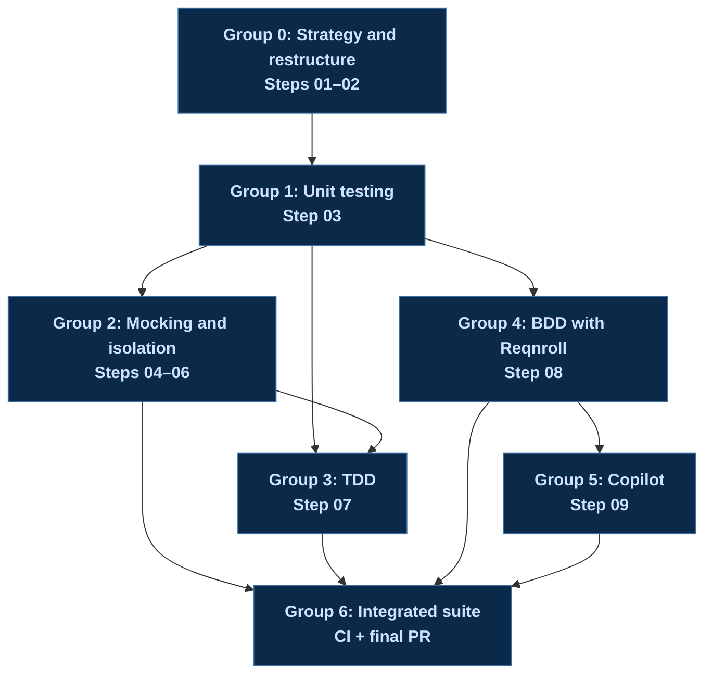
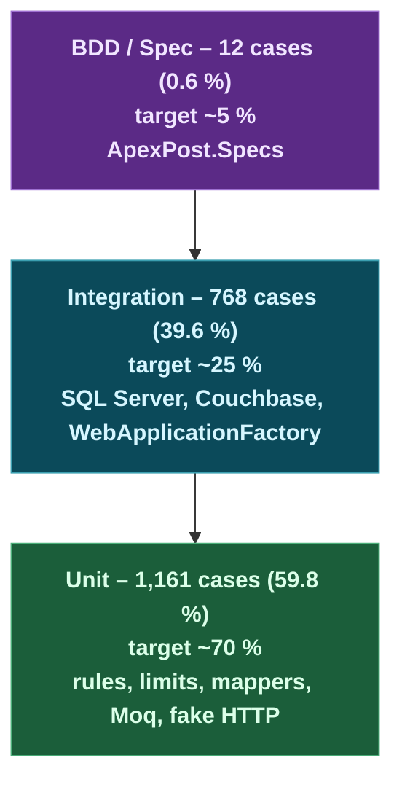
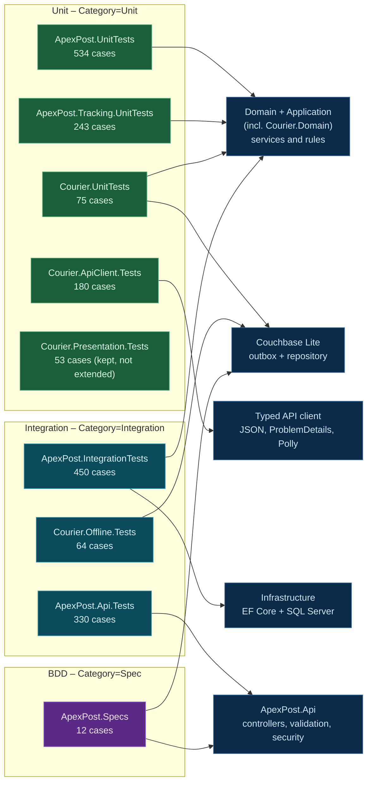
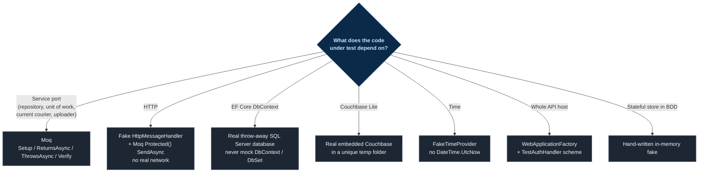
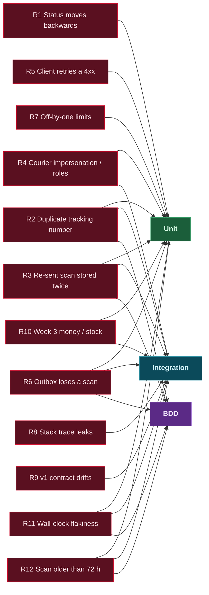

# Week 5 test strategy – diagrams

Visual summary of [TESTING-STRATEGY.md](../../TESTING-STRATEGY.md). The numbers are the real counts from the
full run after step 08 (section 3.8 of the strategy): **1,941 passed, 0 failed, 0 skipped**.
The diagrams are Mermaid and render directly on GitHub.

## 1. How the Week 5 work builds up

Each box is a group of Week 5 steps. An arrow means "builds on". Unit tests come first; mocking, TDD and BDD
reuse their rules and helpers; everything meets in the integrated suite that CI runs on every push.

| Group | Steps | What it delivers | Main files |
| --- | --- | --- | --- |
| 0 Strategy and restructure | 01, 02 | Risk map, pyramid, review of existing tests, one SQL Server lookup, `Category` trait on every class, fixed `FakeTimeProvider` in both test hosts | `TESTING-STRATEGY.md`, `tests/Common/` |
| 1 Unit testing | 03 | Full 6×6 status-transition matrix, tracking-number and courier-id theories, weight / page / upload boundaries, exact exception type and message | `ShipmentStatusRulesTests`, `TrackingLimitsTests` |
| 2 Mocking and isolation | 04, 05, 06 | Moq for service ports, fake and Moq `Protected()` HTTP handlers, real SQL Server repositories, `WebApplicationFactory` end-to-end with a test auth scheme | `ShipmentTrackingServiceMoqTests`, `ApexApiClientHttpHandlerTests`, `TrackingRepositorySqlTests`, `ShipmentLifecycleEndToEndTests` |
| 3 TDD | 07 | 72-hour scan-age rule built RED → GREEN → TEST → REFACTOR | `ScanAgeRuleTests`, `ScanAgePolicy`, `TDD-LOG.md` |
| 4 BDD with Reqnroll | 08 | Shipment creation (API level) and scan sync (service level) features with Background and Scenario Outline | `tests/ApexPost.Specs/Features/` |
| 5 Copilot | 09 | Prompts, kept / changed / rejected decisions, mutation proofs | `docs/copilot/`, `COPILOT-LOG.md` |
| 6 Integrated suite | all | Build with 0 warnings, full suite in CI with a SQL Server container, 0 skipped | `.github/workflows/ci.yml` |

## 2. Test pyramid (real counts after step 08)

Rule: **prove each rule once, at the lowest level that can prove it. Higher levels check wiring only.**

The integration share is above target on purpose: the Week 3 server-rendered pages have no other tests
(strategy section 3.9). The Spec share is small on purpose: each scenario shows a business outcome whose rules
are already proved below (strategy section 9).

## 3. Test projects, levels and the code they cover

## 4. Test doubles: which one where

The SQL Server lookup order is the same for every SQL test: CI variable `ConnectionStrings__ApexPostTestServer`
→ user-secrets → LocalDB on Windows → `Assert.Skip` locally (never skipped in CI).

## 5. Risks and the level that proves them

Full risk table with likelihood, cost and test classes: [TESTING-STRATEGY.md section 2](../../TESTING-STRATEGY.md#2-risk-map).
